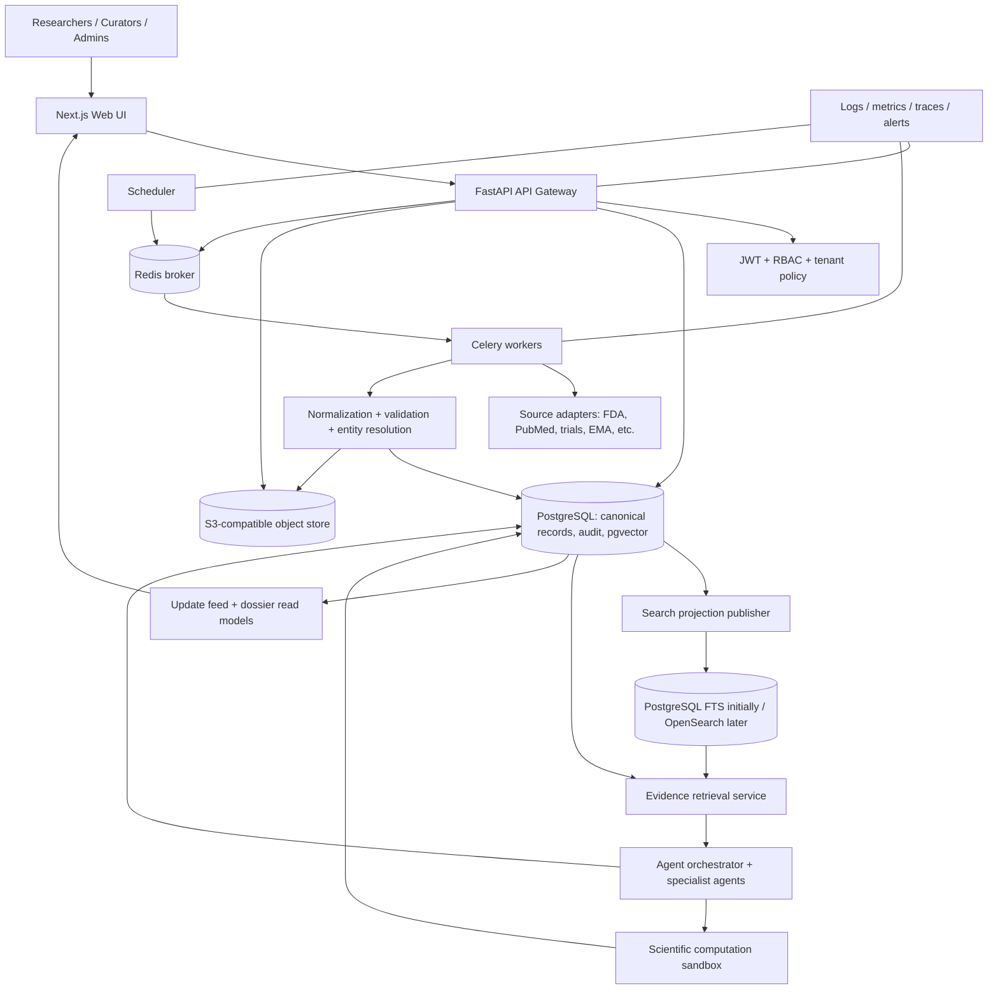
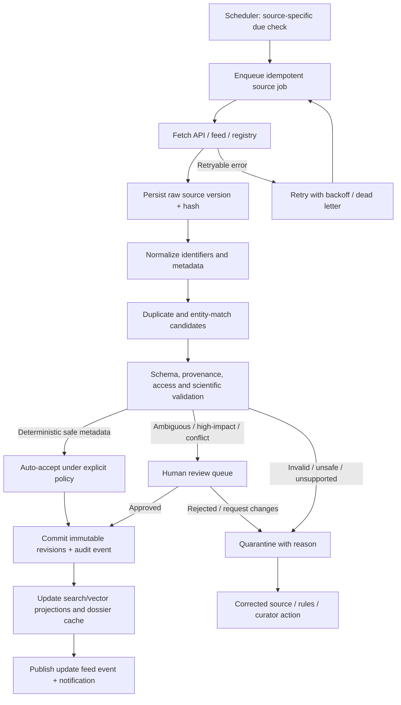
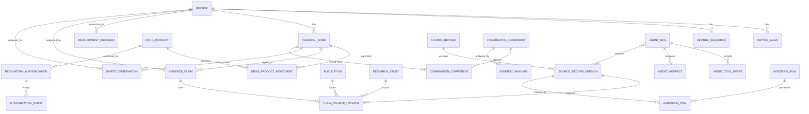

# Peptide Intelligence Platform — Product and Technical Blueprint

**Status:** Approved architectural direction; implementation roadmap, not a claim that the capabilities below are already deployed.

## 1. Product objective

Build a continuously maintained, evidence-first peptide intelligence platform that provides a unified scientific dossier for each peptide or chemically distinct peptide form. The platform must cover:

- FDA-approved peptide drug products and their exact approved labels, indications, routes, dosage forms, approval history, and jurisdiction.
- Peptides that are not FDA-approved, including investigational, preclinical, discontinued, withdrawn, rejected, and research-only candidates.
- Peptide candidates proposed for future development, but only when traceable literature, patents, target biology, unmet need, or other documented rationale exists.
- Identity, sequence, stereochemistry, chemical modifications, structure, physicochemical properties, targets, mechanisms, pharmacology, clinical and preclinical evidence, safety signals, regulatory history, analytical characterization, formulation/stability evidence, manufacturing/process-development literature, suppliers and facilities, and source provenance.
- A continuously refreshed global research and regulatory update stream.
- AI research agents and computational workbenches for evidence synthesis, peptide comparison, interaction hypotheses, combination/synergy analysis, and safety-signal exploration.

The platform is an evidence and research intelligence system. It is not a clinical decision-support system, a patient-specific treatment recommender, or an automated authority for regulatory or manufacturing decisions.

## 2. Core scientific and regulatory rules

### 2.1 Approval is a product-, indication-, and jurisdiction-specific fact

Do not store a single unqualified boolean such as `is_fda_approved` on a peptide identity. Regulatory authorization attaches to a particular product/chemical form, sponsor/holder, formulation, route, indication, label and jurisdiction at a point in time.

Represent at least:
- jurisdiction and authority;
- application / authorization identifier and pathway where available;
- exact product and active ingredient / chemical form;
- sponsor or marketing authorization holder;
- indication, population, route and dosage form as stated by the source;
- original approval, supplemental approvals, current status, withdrawal/discontinuation dates and reasons when officially documented;
- label/document version, source URL, retrieval time and effective date;
- evidence status: official source, secondary source, unresolved mapping, or curator-reviewed.

“Not FDA-approved” must not be inferred from absence in one search. Use explicit states such as `not_found_in_checked_sources`, `investigational`, `not_approved_in_jurisdiction` (only with adequate evidence), `withdrawn`, `discontinued`, `rejected`, and `unknown`. Preserve country differences. A medicine approved by EMA, MHRA, CDSCO or another authority is not thereby FDA-approved.

### 2.2 Evidence classes must never be collapsed

Every scientific value and claim must identify its origin and evidence class:
- measured experimental result;
- human clinical observation or trial result;
- animal / in-vivo preclinical result;
- in-vitro / ex-vivo result;
- computational prediction or simulation;
- source-reported assertion;
- AI-extracted candidate claim;
- curator interpretation.

Retain study design, organism/population, sample size where reported, comparator, endpoint, assay/model, conditions, result, uncertainty, limitations, source locator, and conflicts. A publication, trial registration, patent, vendor claim, or AI summary is not itself proof of efficacy, safety, approval, purity, or validated capability.

### 2.3 Predictions are hypotheses, not proven outcomes

Combination synergy, target interaction, efficacy, toxicity and future ADR models must display model type, training/evaluation domain, assumptions, calibration, uncertainty, applicability domain and known limitations. Do not present a predicted interaction or ADR as experimentally or clinically confirmed. Do not provide patient-specific combination recommendations, dosing, or instructions for self-administration.

## 3. The peptide dossier: one-click access

Each canonical peptide identity should have a stable dossier route, with chemically distinct forms and product presentations represented as linked but non-interchangeable entities.

Suggested dossier sections:
1. Overview and identity confidence
2. Regulatory status by jurisdiction and exact product
3. Sequence, residue encoding, stereochemistry and modifications
4. Chemical forms, salts, conjugates, cyclization and identity fingerprints
5. Structure and computational/experimental structural evidence
6. Targets, mechanisms and pathway context
7. Pharmacology and PK/PD evidence
8. Human clinical trials and publications
9. Preclinical and in-vitro evidence
10. Safety / ADR evidence and signal history
11. Combination research and interaction hypotheses
12. Analytical testing, method applicability and validation evidence
13. Formulation, delivery and stability evidence
14. Process-development and manufacturing literature (non-operational evidence catalogue)
15. Vendors, facilities, certificates, materials and batch traceability
16. Patent and future-development landscape
17. Global research updates and timeline
18. Complete source register, review decisions, revisions and audit history

The user-facing interface should load a concise dossier summary quickly, with expandable sections and direct links to original sources. Use a relational database and stable peptide IDs as the source of truth; do not create one physical database table or manually maintained filesystem directory per peptide. Provide a virtual per-peptide folder/dossier view. Store large source documents and derived artifacts in object storage using a predictable path such as `/peptides/{peptide_id}/{artifact_type}/{source_record_id}/{version}`, while metadata and permissions remain in PostgreSQL. A dossier must be accessible from catalogue search in one click.

## 4. Regulatory and development lifecycle taxonomy

Use separate dimensions rather than one overloaded development-status field.

### Regulatory status (per product and jurisdiction)
- approved;
- conditionally / emergency authorized (where the authority uses that category);
- under review;
- refused / rejected;
- authorization withdrawn;
- discontinued / no longer marketed;
- not found in checked official sources;
- unknown / unresolved.

### Research / development stage (per candidate)
- discovery / design;
- computationally proposed;
- in-vitro research;
- in-vivo preclinical;
- IND/CTA-enabling (source-supported);
- clinical phase I, II, III;
- filed / under regulatory review;
- marketed in at least one jurisdiction;
- paused / suspended;
- terminated / discontinued;
- stage unknown.

These states are not interchangeable. A peptide can be approved in one country and investigational in another. A research candidate is not “future-ready” merely because an AI agent generated it.

## 5. Global daily intelligence and automatic ingestion

### 5.1 Source families

Build source adapters with source-specific terms of use, API limits, licensing, identifiers and update semantics. Prioritize official or primary sources:

- Regulatory: FDA Drugs@FDA, FDA labels / DailyMed, FDA safety communications and relevant official databases; EMA, MHRA, CDSCO, WHO and other national authority sources where machine-readable access is available.
- Trials: ClinicalTrials.gov and other official trial registries with documented APIs.
- Literature: PubMed / NCBI, Europe PMC and publisher metadata feeds where permitted.
- Chemistry and identity: PubChem, UniProt and authoritative sequence/structure resources, with identity resolution review.
- Structure: RCSB PDB and AlphaFold DB, preserving experimental versus predicted status.
- Patents: official patent-office / WIPO sources and licensed metadata providers.
- Safety: official regulatory safety notices, label changes and public pharmacovigilance sources with denominator and reporting-bias caveats.
- Research signals: preprints and other secondary sources clearly labelled as non-peer-reviewed.

The list is extensible. Source availability, licensing, API terms and actual update frequency must be checked before each integration is enabled.

### 5.2 Daily update pipeline

Implement a scheduled, resumable, idempotent pipeline:
1. Discover changed/new source records using official APIs, feeds, cursors, ETags, modified dates or source-specific incremental methods.
2. Persist raw retrieval metadata and payload or permitted archival representation before transformation.
3. Compute content hashes and immutable source versions; never overwrite prior source payloads.
4. Normalize identifiers, dates, organizations, products, peptide aliases and source links.
5. Resolve candidate entity matches with method, confidence and evidence; uncertain matches go to a review queue.
6. Extract structured claims with model/version and extraction provenance.
7. Validate schemas, required fields, identifiers, date logic, source domain, content hash, duplicate keys, foreign keys, tenant scope and state transitions.
8. Run scientific consistency checks and compare changes with existing claims, including contradictions and retractions.
9. Auto-publish only low-risk, deterministic metadata from allowlisted authoritative sources under explicit rules. Keep scientific interpretations, safety conclusions, regulatory mappings and uncertain identity matches in a review queue.
10. Update search indexes, dossier caches and the global update feed only after validation and policy checks.
11. Record every run, source cursor, counts, errors, retries, rejected rows, review backlog and last-success timestamp.
12. Alert operators when a source fails, schema changes, ingestion falls behind, or an unusual change is detected.

“Without manual requirement” means routine discovery, retrieval, deduplication, deterministic validation, versioning, indexing and dashboard refresh are automated. It does not mean bypassing scientific review for ambiguous or high-impact claims. No system can guarantee that every global publication or regulatory change is discovered immediately; show source coverage and last-checked times.

### 5.3 Reliability requirements

- Per-source schedules and rate limits; no single global cron that can silently fail.
- Idempotency keys and replay-safe processing.
- Retry with backoff, dead-letter handling and operator-visible failures.
- Per-source watermarks/cursors and gap detection.
- Monitoring for source schema changes, broken feeds and stale data.
- Immutable run logs and audit events.
- Reconciliation jobs to detect missing or changed upstream records.
- Tests for duplicate deliveries, interrupted runs, replay, out-of-order updates and partial failures.
- Secrets stored in deployment secret management, never committed to the repository.
- A manual pause / kill switch for a misbehaving source or pipeline.

## 6. AI agent architecture

Agents should be specialized, tool-limited and evidence-grounded. Each agent run stores the question, peptide/form IDs, retrieved source IDs and versions, tool calls, model/provider/version, prompt/template version, output, uncertainty, validation result and review state.

Proposed agents:
- Regulatory & Label Agent: tracks official approval, label, jurisdiction and status changes.
- Literature Surveillance Agent: daily new publications, trials, preprints and retractions.
- Peptide Identity Agent: alias and chemical-form resolution; uncertain matches remain candidates.
- Sequence / Structure Agent: sequence, structure, modifications and model-confidence interpretation.
- Mechanism & Target Agent: maps targets and pathways while separating association from causality.
- Clinical Evidence Agent: extracts trial design, populations, endpoints, results and limitations.
- Safety / ADR Agent: organizes reported events and official safety actions; does not infer incidence from spontaneous reports without suitable denominators.
- Combination Research Agent: evaluates mechanistic rationale and available combination evidence.
- Synergy Modelling Agent: runs pre-registered, reproducible analyses when compatible experimental data exist.
- Analytical / Quality Agent: maps identity, purity, impurities, assay and method-validation evidence.
- Formulation / Stability Evidence Agent: indexes published evidence and conditions.
- Vendor / Facility Evidence Agent: verifies source-linked claims and certificate scope.
- Scientific Review Agent: checks evidence completeness, contradictions, unsupported claims and source quality.
- Daily Briefing Agent: produces a concise, cited digest of validated new and changed records.

Agents must not self-approve, self-publish high-impact claims, alter source evidence, or silently overwrite curated records. All writes are drafts with provenance and validation state.

## 7. Combination and synergy computation

The platform should support a research-grade combination workbench, not an unqualified “synergy calculator”.

### Required inputs
- exact peptide chemical-form identity and batch/material context where relevant;
- each component's experimental concentration or exposure range and units;
- compatible assay, biological system, endpoint, time point and experimental design;
- single-agent dose-response curves and combination response matrix;
- replicate count, controls, normalization and uncertainty;
- source dataset / publication and provenance.

### Analysis methods
Support only methods whose assumptions fit the experiment, potentially including:
- Bliss independence;
- Loewe additivity / isobolographic analysis;
- Highest Single Agent (HSA);
- ZIP response-surface analysis;
- dose-response and response-surface models with confidence intervals / bootstrap uncertainty.

Do not treat different synergy models as interchangeable. Report each method's assumptions, fitted parameters, goodness-of-fit, uncertainty, sensitivity and applicability. Require compatible single-agent and combination measurements. If only literature rationale or docking evidence exists, return a mechanistic hypothesis, not a numerical synergy score. If data are insufficient, abstain.

For three or more components, account for combinatorial explosion, sparse designs, interaction terms, multiplicity and overfitting. Do not extrapolate beyond tested concentration ranges without an explicit warning and validated model.

### ADR and safety exploration for combinations

Build a separate safety evidence graph and prediction module:
- observed adverse events from trials, labels and published studies;
- official safety communications and label changes;
- preclinical toxicity and mechanistic evidence;
- known class effects and target/pathway overlap;
- pharmacokinetic / pharmacodynamic interaction evidence where available;
- spontaneous-report signals only with explicit reporting-system bias, confounding and lack of exposure denominators.

A predicted future ADR must be labelled `hypothesis` or `model_prediction`, with evidence links, rationale, confidence/uncertainty, model version, applicability domain and required validation experiments. Do not state that an ADR “will occur”. Do not calculate patient-specific risk or recommend a peptide combination for use.

## 8. Data architecture principles

Use normalized PostgreSQL entities with immutable histories and materialized read models for fast dossier display. Key entity groups:
- peptide identities and aliases;
- peptide sequences and chemical forms;
- products / presentations and jurisdiction-specific regulatory authorizations;
- development programs and lifecycle events;
- source records and immutable source versions;
- publications, trials, patents and regulatory documents;
- evidence claims, claim-source locators, appraisals and decisions;
- targets, pathways, structures and interaction evidence;
- ADR / safety observations and safety actions;
- combination experiments, response matrices, synergy analyses and model runs;
- formulation, stability, process and analytical method evidence;
- vendors, facilities, certifications, materials and batches;
- ingestion sources, schedules, cursors, runs, artifacts and validation findings;
- agent definitions, runs, tool events, drafts and approvals;
- global update feed events and dossier index/cache metadata.

All records must have stable identifiers, explicit ownership/visibility, source provenance, created/updated timestamps, version semantics and audit coverage appropriate to their data class. Decisions must bind to immutable revisions. Preserve original units and source values alongside normalized values; never silently convert or replace the source observation.

## 9. Fast, uncluttered user experience

- Global search by peptide name, alias, sequence, product, target, trial, publication or regulatory identifier.
- Search result opens the dossier directly.
- Dossier overview shows identity, regulatory status by jurisdiction, development stage, evidence summary, safety notices and last successful update.
- Tabs / sections keep content organized; filters distinguish approved, investigational, preclinical, withdrawn, unknown and future-development candidates.
- “Latest global updates” feed with date, source, peptide, update type, evidence class, review state and direct dossier link.
- Clearly distinguish new, changed, under review, validated metadata, curator verified, prediction and conflicting evidence.
- Load summary and cached high-value facts first; lazy-load heavy publications, structures and analysis artifacts.
- Each visible claim should open its source locator and show when it was retrieved and reviewed.
- Show data gaps explicitly rather than rendering empty values as facts.

## 10. Implementation roadmap and release gates

### Phase 0 — Architecture and acceptance contracts
- Freeze entity boundaries, approval taxonomy, evidence classes, update states, ownership and agent governance.
- Map existing schema/routes/integrations to target entities and identify reuse versus gaps.
- Define representative test fixtures and end-to-end acceptance criteria.

### Phase 1 — Regulatory product truth
- Model product-level authorization by jurisdiction, label and immutable status history.
- Integrate official FDA sources first; then add other authorities through source adapters.
- Build the regulatory timeline and reviewable mapping to peptide chemical forms.

### Phase 2 — Per-peptide dossier and global search
- Complete dossier API/read model and one-click profile navigation.
- Build sections, evidence links, source timeline and data completeness indicators.

### Phase 3 — Automated research surveillance
- Add scheduled source connectors, incremental sync, validation, immutable versions, retries, monitoring and update feed.
- Begin with PubMed, ClinicalTrials.gov and official FDA updates; expand only after source-specific tests and licensing review.

### Phase 4 — Safety and evidence intelligence
- Normalize clinical/preclinical safety observations, ADR terminology, label changes and signal limitations.
- Build contradiction/retraction handling and evidence-quality review.

### Phase 5 — Combination and synergy workbench
- Add experiment schema and validated statistical methods.
- Test against published benchmark datasets and synthetic fixtures with known behavior.
- Require input compatibility checks, uncertainty reporting and abstention.

### Phase 6 — AI agent orchestration
- Implement specialized agents, source-retrieval allowlists, tool permissions, reproducible run logs and draft-only writes.
- Add semantic support review beyond simple citation-ID matching.

### Phase 7 — Scale and operational hardening
- Load testing, indexing, caching, observability, backup/restore drills, source coverage dashboards, security review and deployment validation.

### Release gates
No phase is complete merely because tables or UI pages exist. Require migration tests, API tests, frontend build, source adapter fixtures, security/tenant tests, provenance tests and documented limitations. Production ingestion additionally requires configured credentials/secrets, deployed scheduler/worker, monitoring, alerting, backup/restore validation and verified source terms.

## 11. Initial measurable acceptance criteria

- Regulatory status cannot be displayed without authority, jurisdiction, exact product/form mapping, source and last-checked timestamp.
- A missing FDA match never automatically becomes a confirmed “not approved” claim.
- Every imported source has immutable version history and reproducible retrieval metadata.
- A replayed ingestion event creates no duplicate source or claim.
- Invalid, conflicting or ambiguous records are quarantined without corrupting curated data.
- Dossier pages expose source links, evidence class, review state and last-updated time.
- Every AI output is reproducible from a stored run manifest and supplied source versions.
- A synergy score is unavailable when required single-agent / combination data or compatible assay context is missing.
- A model prediction is always visibly distinguished from experimental or clinical evidence.
- High-impact regulatory, clinical and safety claims cannot be auto-published solely by an LLM.
- Scheduled ingestion failures are observable and recoverable; the system exposes last successful run per source.
- Cross-tenant data remains isolated across API, search, dossier, agent and background-worker paths.

## 12. Existing repository baseline and known gaps

The repository already contains useful foundations: PostgreSQL migrations through 065; peptide identity and chemical-form records; immutable revisions for chemical forms and evidence claims; source provenance; PubMed, ClinicalTrials.gov, UniProt, RCSB and PubChem discovery clients; regulatory guidance and polling infrastructure; evidence extraction/review; analytical, formulation, process, vendor and interaction modules; agent sessions and specialized research agents; and a Next.js peptide catalogue/profile.

These foundations do not yet establish the full product described here. In particular:
- the peptide sequence canonicalizer intentionally supports only unmodified standard linear sequences;
- regulatory guidance/polling infrastructure is not yet a complete product-level authorization and FDA-label history system;
- the existing discovery integrations are not equivalent to a production daily ingestion service with monitored schedules and complete source coverage;
- current peptide directory/profile shows curator-verified records, not a complete global peptide landscape;
- the AI synthesis citation audit checks identifier presence, not semantic claim support;
- no validated multi-peptide synergy analysis or prospective ADR prediction system is established by this blueprint;
- no guarantee of complete worldwide coverage or real-time discovery should be made.

**Architecture decision:** Build the platform as an evidence-first, source-versioned, multi-jurisdictional peptide knowledge system with automated ingestion and controlled scientific publication. Expand breadth only after identity, provenance, validation, safety and ownership guarantees are testable.


## 13. Concrete reference architecture and technology decisions

The architecture is modular, API-first and event-driven. Preserve PostgreSQL as the transactional source of truth. Add infrastructure only when a phase needs it; do not introduce Elasticsearch, Redis, object storage and an agent framework as disconnected dependencies before their contracts and operational needs are tested.

### 13.1 Recommended technology choices

| Capability | Initial choice | Expansion path / decision rule |
|---|---|---|
| Transactional database | PostgreSQL 16+ with JSONB, pgcrypto and pgvector | Partition high-volume append-only event/source tables only after measured query and retention needs. |
| Scientific full-text search | PostgreSQL full-text + trigram indexes for early releases | Add OpenSearch when multilingual, faceted, typo-tolerant, cross-entity search or measured load exceeds PostgreSQL's acceptable latency/operational envelope. Keep PostgreSQL canonical; index documents are rebuildable projections. |
| Vector retrieval | pgvector in the existing PostgreSQL deployment | Start with pgvector to avoid a second database and simplify tenant isolation. Evaluate a separate vector service only after benchmarked scale, isolation or retrieval requirements justify it. Store embedding model/version and source chunk revision. |
| Document / artifact storage | S3-compatible object storage; MinIO for local development and S3-compatible cloud bucket in deployment | Keep object keys in PostgreSQL metadata. Enable encryption, versioning, retention policy, checksum verification and least-privilege access. |
| Background processing | Celery workers with Redis broker/result backend | Separate queues by workload and priority. Redis is not the durable scientific record; jobs and outcomes must also be persisted in PostgreSQL. Evaluate managed queues if operations demand it. |
| Scheduling | Celery Beat or a managed scheduler submitting idempotent jobs | Scheduler only enqueues work; workers own retries, locks and checkpoints. |
| API | Existing FastAPI + Pydantic + SQLAlchemy | Versioned REST APIs; OpenAPI contract; async task submission returns durable job IDs. |
| Frontend | Existing Next.js / TypeScript application | Componentized dossier sections and query-driven search; avoid duplicating domain rules in the browser. |
| AI orchestration | Modular internal agent contracts and tool registry first; LangGraph or equivalent may be evaluated behind an adapter | Keep provider/framework replaceable. Agents are stateless workers around persisted run manifests, not trusted authorities. |
| Scientific computing | Python; RDKit; Biopython; NumPy; SciPy; pandas; statsmodels; scikit-learn | Use specialized validated packages for dose-response / synergy only after benchmark review. Pin versions and record environment/container digest. PyTorch or other deep-learning stack only for a justified model and governed dataset. |
| Authentication / authorization | Existing JWT authentication, organization membership, role checks and PostgreSQL RLS | Add least-privilege service identities, scoped API tokens, MFA/SSO as needed, permission tests for every API, search index and worker. |
| Deployment | Docker Compose for reproducible local development; container images for cloud deployment | Production: managed PostgreSQL, Redis/queue, object storage, container orchestration, secrets manager, TLS, backups and observability. Kubernetes is optional, not a prerequisite for MVP. |
| Observability | Structured logs, metrics, traces, error reporting and source/job health dashboards | OpenTelemetry-compatible instrumentation; alerts tied to SLOs and source freshness. |

**Search decision:** Do not deploy OpenSearch on day one merely because it is available. Use PostgreSQL search for the first reliable dossier and ingestion releases, benchmark with representative peptide, alias, sequence, publication, trial and target queries, then add OpenSearch as a derived search projection if required.

**Vector decision:** pgvector is the preferred starting point because the repository already enables the PostgreSQL vector extension. Embeddings are retrieval aids, not evidence and not a replacement for keyword/identifier search. Retrieval must filter by access scope, review state and source version before returning chunks.

### 13.2 Logical service architecture



The diagram is logical, not a claim that each box currently runs as a separate deployed microservice. Begin as a modular monolith plus independently scalable worker processes. Extract services only when ownership, scaling or reliability boundaries justify it.

### 13.3 Data flow: automated source update



Every transition must be persisted. Search/vector indexes and caches are rebuildable projections; the source version, claim revision, review decision and audit event are canonical. Reversal means creating a superseding/reversal event and restoring a prior approved revision through a new event—not deleting the history.

### 13.4 Scientific computation and agent isolation


The agent planner must not be able to bypass tool allowlists or tenant filters. Scientific code runs in a resource-limited container with no arbitrary network access by default. Inputs and outputs are size-bounded and typed. Source text is untrusted data, never executable instructions. Model outputs are drafts; only deterministic, explicitly allowlisted metadata updates may auto-publish.

## 14. Logical database schema and relationship map

The schema below is the target domain model. It maps to and extends existing tables; it is not a direction to create duplicate parallel tables. Before every migration, map each proposed entity to the current schema, identify the canonical owner, and write a forward-only migration with backfill and rollback/recovery plan.

### 14.1 Main entity groups

| Domain | Canonical entities / proposed logical tables | Core relationships |
|---|---|---|
| Identity | `peptides`, `peptide_aliases`, `peptide_sequences`, `peptide_chemical_forms`, identity match candidates | One peptide has aliases, sequence variants and one or more chemically distinct forms. Similarity is not identity. |
| Product & regulation | `drug_products`, `product_ingredients`, `regulatory_authorizations`, `authorization_indications`, `regulatory_documents`, `authorization_events` | Authorization is attached to exact product/form, authority, jurisdiction, label and indication; status changes are append-only events. |
| Development | `development_programs`, `development_milestones`, `candidate_rationales` | Candidate/program links to peptide/form, sponsor, target indication and source-backed stage history. |
| Sources | Existing `source_records`, plus immutable `source_record_versions`, `source_connectors`, `source_cursors`, `ingestion_runs`, `ingestion_items` | One source has versioned payloads and retrieval runs; jobs are idempotent and replayable. |
| Publications & trials | Existing `publications`, `research_studies`, registry-specific identifiers and document links | Peptides/forms/programs link to multiple publications, trial interventions and study arms. |
| Evidence | Existing `evidence_claims`, `evidence_claim_revisions`, `claim_source_locators`, `evidence_appraisals`, append-only review decisions | A claim can have multiple sources, revisions and conflicting appraisals. Decisions bind to exact revisions. |
| Biology | Existing `targets`, `pathways`, `structures`, peptide-target evidence and pathway associations | Target/pathway claims are typed, organism-specific and source-linked. |
| Safety | `safety_observations`, `adverse_event_terms`, `safety_actions`, `safety_signal_analyses`, `safety_model_runs` | Observations and regulatory actions are distinct from model-predicted safety hypotheses. |
| Combination science | `combination_experiments`, `combination_components`, `dose_response_observations`, `combination_response_matrices`, `synergy_analyses`, `synergy_model_runs` | Experiments reference exact forms, assay/model, endpoints, units, time points, replicates and source provenance. |
| Analytical / formulation / process | Existing analytical-method, formulation, stability and process-development entities | Evidence is linked to exact material/form, intended purpose, matrix, conditions and validation scope. |
| Supply chain | Existing vendors, facilities, certifications, services, material lots and traceability entities | Claims about capabilities and certification scope require source evidence and verification dates. |
| AI / automation | `agent_definitions`, `agent_runs`, `agent_tool_events`, `agent_artifacts`, `agent_proposed_claims`, `validation_findings`, `notifications` | Each run stores input context, model/prompt/tool versions, retrieved source versions, output hashes and review state. |
| Search / files | `document_assets`, `document_chunks`, `embedding_records`, `search_projection_events` | Object storage holds bytes; PostgreSQL holds metadata, hashes, access scope and index versions. |

### 14.2 Entity relationship diagram



ER diagram is conceptual. Exact cardinalities, nullable relationships, tenant ownership, deletion semantics and table names are finalized through migration-level design review. Do not create a generic entity-attribute-value schema for scientific core facts; use typed relational columns and JSONB only for genuinely variable, source-preserved payloads.

### 14.3 Key data contracts

- **Peptide identity:** stable peptide entity; raw sequence/notation retained; each chemical form separately identifies residue stereochemistry, noncanonical residues, terminal chemistry, PTMs, cyclization, conjugation and counterions.
- **Product identity:** brand/generic product presentation is not the same entity as peptide identity. Product contains one or more active ingredients/forms and may have multiple labels and authorization histories.
- **Regulatory authorization:** unique within authority/application/product/jurisdiction scope; never derive approval from a peptide-level boolean.
- **Source version:** source name + source identifier + retrieved time + canonical URL + content hash + permitted payload reference + connector version + parser version.
- **Scientific claim:** typed claim, exact subject/form, predicate/domain, value/unit if applicable, evidence class, study context, limitations, source locators, extraction origin, validation status and immutable revision.
- **Safety observation:** event term, event context, source type, exposure denominator availability, population/model, seriousness/outcome when reported, confounding caveats and evidence class. A spontaneous report is not incidence.
- **Synergy analysis:** experiment ID, exact components/forms, response matrix, assay/endpoints, method, software/version, parameters, uncertainty, diagnostics, applicability and abstention reason.
- **Agent run:** run ID, agent and prompt version, model/provider, tool registry version, user/org scope, input hashes, retrieved source-version IDs, output hash, validation findings, review state and timestamps.

## 15. API design contract

Use versioned REST resources under `/api/v1`. All list endpoints support bounded pagination, stable sorting, filters, and explicit scope. All writes are authenticated, role-checked, tenant-scoped, rate-limited and audited. Long-running operations return `202 Accepted` with a durable job/run resource.

| Resource | Representative endpoints | Purpose |
|---|---|---|
| Peptides | `GET /peptides`, `GET /peptides/{id}`, `GET /peptides/{id}/dossier`, `GET /peptides/{id}/timeline` | Search and open one-click dossier. |
| Chemical forms | `GET /peptides/{id}/forms`, `GET /forms/{form_id}`, curator-only revision endpoints | Exact form identity and immutable revisions. |
| Products / regulation | `GET /products`, `GET /products/{id}/authorizations`, `GET /regulatory/authorities`, `GET /regulatory/changes` | Product-specific, jurisdiction-specific authorization and label history. |
| Research | `GET /research/publications`, `GET /research/trials`, `GET /research/updates` | Literature, trials and global update feed. |
| Evidence | `GET /claims`, `GET /claims/{id}`, `GET /claims/{id}/sources`, `POST /curation/claims/{id}/decisions` | Source-linked claims and review. |
| Safety | `GET /peptides/{id}/safety`, `GET /safety/signals`, `GET /safety/actions` | Observed events and separately labelled signal analyses. |
| Combinations | `POST /combination-experiments`, `POST /synergy-analyses`, `GET /synergy-analyses/{id}` | Register compatible data and run validated analyses asynchronously. |
| Agents | `GET /agents`, `POST /agent-runs`, `GET /agent-runs/{id}`, `POST /agent-runs/{id}/review` | Execute specialized research tasks and review drafts. |
| Ingestion | `GET /admin/ingestion/sources`, `GET /admin/ingestion/runs`, `POST /admin/ingestion/runs`, `POST /admin/ingestion/runs/{id}/retry` | Monitor and operate source pipelines. |
| Search | `GET /search?q=...`, `GET /search/suggest?q=...` | Unified search with scope and evidence-state filters. |
| Operations | `GET /health/live`, `GET /health/ready`, `GET /admin/metrics/ingestion` | Liveness, readiness and operational status. |

### API response envelope

Use a consistent response contract (illustrative, not a current implementation):

```json
{
  "data": {},
  "meta": {
    "request_id": "uuid",
    "retrieved_at": "ISO-8601",
    "source_freshness": "timestamp-or-status",
    "next_cursor": null
  },
  "warnings": []
}
```

Errors should use stable machine-readable codes, safe user-facing detail and request IDs. Never expose SQL, secrets, internal source payloads or cross-tenant existence. OpenAPI schemas and generated contract tests are required before frontend integration.

### Security contract

- Roles are capabilities, not labels alone: public reader, organization researcher, curator, qualified reviewer, organization admin, platform operator and service identity.
- Enforce organization/tenant scope at API, SQL query, PostgreSQL RLS, background job, object-storage key and search/vector retrieval layers.
- A worker must receive a scoped service identity and explicit task permissions; do not use a superuser connection for routine ingestion.
- Review decisions must bind to the immutable claim/form/product revision reviewed.
- Read-only public endpoints return only approved public projections.
- Security tests must include IDOR, cross-tenant reads/writes, stale membership, privilege escalation, job replay, object-key traversal and index leakage.

## 16. Validation, provenance, audit and reversible automation framework

Validation is layered. A row passing a JSON schema is not thereby scientifically valid.

| Gate | Checks | Failure behavior |
|---|---|---|
| G0 Transport | HTTPS, host allowlist, content type/size, timeout, redirect and source terms | Reject or quarantine unsafe response. |
| G1 Source identity | Stable identifier, canonical URL, source/version, retrieved time, content hash | Quarantine missing or contradictory provenance. |
| G2 Structural | Pydantic/schema validation, types, required fields, units, dates, enumerations | Reject item with machine-readable findings. |
| G3 Entity resolution | Alias/sequence/form/product match, species, stereochemistry, chemical form, confidence | Candidate match queue; never auto-merge uncertain entities. |
| G4 Scientific consistency | Contradictions, unit conversion, impossible values, study context, duplicate records, retraction/correction | Quarantine or send for expert review. |
| G5 Evidence and citations | Locator validity, source version, DOI/PMID/registry ID, claim-to-source support review | Mark citation unverified or require review; identifier presence alone is insufficient. |
| G6 Policy and access | Tenant ownership, role, source license, publication policy, sensitive data and safety constraints | Block write/publication. |
| G7 Publication | Exact revision approved, audit event committed, index projection succeeds or is retryable | Publish atomically to canonical DB; projection retries do not alter canonical state. |

### Immutable change event

Every accepted or rejected automated change should record:
- event ID and idempotency key;
- source connector, source record ID and immutable source-version ID;
- peptide/product/form/claim IDs affected;
- previous revision ID and proposed/new revision ID;
- raw and normalized content hashes;
- validation ruleset version and each finding/result;
- agent/service identity, agent version, model/prompt/tool version where applicable;
- decision type, auto-policy or human reviewer and rationale;
- event timestamp, correlation ID, ingestion run and retry lineage.

A rollback is a new, audited compensating event that points to the prior revision and records why. Never delete source history or rewrite the previous state. Backups are a separate disaster-recovery control and must be encrypted, access-controlled, retention-governed and restoration-tested.

## 17. Operational data automation

### Daily services

- Source discovery and incremental fetch by connector-specific cadence.
- Metadata enrichment and cross-reference resolution.
- DOI/PMID/trial/authorization identifier normalization and citation locator checks.
- Exact and fuzzy duplicate candidate detection; fuzzy matches remain reviewable.
- Schema, domain, scientific, policy and ownership validation.
- Scientific classification with explicit model/extractor version and confidence; low confidence goes to review.
- Source-to-source update comparison, retraction/correction checks and conflict preservation.
- Immutable revision creation and audit event commit.
- Search/vector projection refresh, dossier cache invalidation and update notification.
- Database backup verification, restore drills, pipeline health and error monitoring.
- Failed-job retry, dead-letter review and replay from saved source version.

### Queue topology

Use separate queues such as `source_fetch`, `normalization`, `enrichment`, `embedding`, `scientific_analysis`, `notifications`, and `maintenance`. Apply per-queue concurrency, timeouts, memory/CPU limits and retry policies. Long-running RDKit/model computations should not block source-fetch or user-facing API workers. Every job has a unique idempotency key and durable PostgreSQL job/run record; Redis queue state alone is not sufficient.

### Backup and recovery

- Automated PostgreSQL base backups and WAL/PITR where supported by the chosen hosting tier.
- S3 object versioning and lifecycle/retention policy; object checksum manifests.
- Encrypted backups with keys outside the database.
- Documented RPO/RTO targets agreed before production.
- Scheduled restoration tests to an isolated environment, including database plus referenced object assets.
- Alert on backup age, failed backup, restore-test failure, storage growth and WAL/archive lag.

### Observability

Expose per-source last success, source watermark, lag, fetched/changed/rejected/duplicate counts, review backlog, job latency, retries, dead-letter count, API latency/error rate, DB connection saturation, object-store failures, search indexing lag, agent token/cost/error counts, and stale dossier percentage. Alerts must be actionable and route to an operator; never silently swallow source failures.

## 18. Phased implementation backlog and deliverables

The user-facing phase sequence is retained. The implementation is broken into independently reviewable modules and pull requests; each phase must pass its release gate before the next phase is marked complete.

| Phase | Work packages | Required deliverables / exit criteria |
|---|---|---|
| 1. Architecture & database design | Schema inventory; target ERD; regulatory/product model; source/version/audit contracts; API OpenAPI outline; threat model; ADRs | Approved architecture docs, migration plan, compatibility matrix, fixtures and acceptance tests. |
| 2. Core database & profile UI | Canonical peptide/form/product dossier; product authorization views; dossier read model; global search; fast section navigation | Tested APIs and profile UI; approved/unknown status semantics; one-click dossier; source locator and freshness display. |
| 3. Source integrations & ingestion | Connector SDK; FDA source adapters; PubMed; ClinicalTrials.gov; source cursors; Celery/Redis; S3 artifacts; retries and run dashboard | Replay-safe daily pipeline, immutable source snapshots, monitored failures, per-source freshness and fixtures. |
| 4. Validation / evidence / citations | Multi-gate validation; DOI/PMID/registry resolution; source locators; contradiction/retraction; review binding | Validation reports, append-only decisions, audit and provenance tests; invalid items cannot contaminate curated projections. |
| 5. AI assistant & agents | Agent contracts; retrieval; tool permissions; run manifests; grounded synthesis; review queue | Reproducible agent runs, semantic citation evaluation, tenant isolation and draft-only writes. |
| 6. Combination analysis | Experiment schema; assay compatibility; dose-response fitting; Bliss/Loewe/HSA/ZIP only where assumptions apply; benchmark fixtures | Reproducible analysis reports, uncertainty and abstention, validated reference datasets, no score for insufficient data. |
| 7. Safety intelligence | Label/clinical/preclinical event evidence; ADR terminology; source bias; signal detection; hypothesis models | Observed-versus-predicted separation, source/denominator caveats, validation and safety review gate. |
| 8. Optimization / security / deployment | Search benchmark and OpenSearch decision; load tests; RLS audit; Docker/cloud deployment; backups; monitoring | Security sign-off, performance SLOs, restore drill, operational runbooks, production readiness review. |

### Phase 1 deliverable checklist

Phase 1 is considered complete only when the repository contains:
- logical and physical schema maps showing existing tables reused versus proposed additions;
- Mermaid component, ingestion, agent, ER and deployment diagrams;
- versioned API contract and error/async-job conventions;
- regulatory and evidence taxonomy;
- source connector interface and idempotency contract;
- validation matrix and append-only audit event schema;
- threat model, tenant isolation plan and role-capability matrix;
- data retention, object-storage and backup/restore policy;
- phase backlog with testable acceptance criteria and migration sequencing.

### Implementation discipline

1. One focused pull request per coherent module; avoid giant all-at-once migrations.
2. Each PR includes schema/API/UI changes, migration tests, unit/integration tests, docs and operational implications as applicable.
3. Use feature flags for new connectors and model workflows; never enable unreviewed writes by default.
4. CI must cover PostgreSQL migrations, API contracts, RLS/tenant isolation, worker idempotency, replay/recovery and frontend builds.
5. Production release requires configured infrastructure and secrets, staging validation, restore test and operator runbook—not merely green GitHub CI.
6. Keep OpenSearch, separate vector DB and Kubernetes optional until evidence from load tests justifies them.
7. Record architectural decisions and migration compatibility; never modify an applied migration.

## 19. Architecture acceptance and non-goals

The system is accepted only when the final platform can demonstrate end-to-end traceability from a visible dossier fact to an immutable source version, extraction/normalization event, validation result, revision and reviewer/policy decision. It must be possible to reproduce the published view, identify what changed, and issue a compensating revision without erasing history.

The architecture explicitly does not promise exhaustive worldwide discovery, instantaneous updates from every publisher, proof of safety/efficacy from computational models, or fully autonomous publication of high-impact scientific conclusions. It is designed to make coverage, uncertainty, provenance, freshness and limitations visible.
